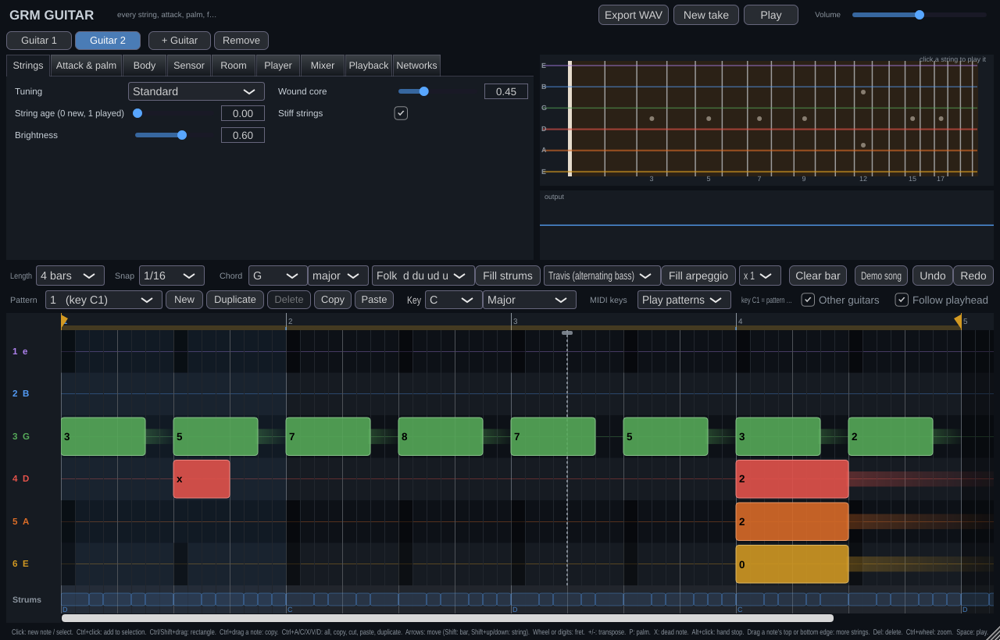

# GRM Guitar 0.2.0

This release is about the player. The strings, body and room are the same as before. What changed is how
the guitar is played: two hands, ten fingers, a pick and a tired arm, all of them GRM networks.

## The hands are constraints

- **The left hand has four fingers.** The thumb can take the low E, a barre counts as one finger, and one
  finger can hold neighbouring strings at the same fret.
- **The stretch is a GRM network.** Each fingertip sits behind its fret, the hand pulls towards its natural
  spread, and the tension left in the network is the strain of the hand. Frets get closer up the neck, so more
  of them fit there. Fret 3 with fret 7 is hard but possible; fret 3 with fret 8 is not.
- **A pick cannot jump a string.** It cannot strike two strings without the ones between. With the fingers,
  at most five strings at once.
- **The roll refuses what no guitarist can play.** An edit that adds an impossible moment is undone and the roll
  says why ("Not playable at bar 3: left hand: stretch from fret 3 to fret 8 is too wide here"). Moments that are
  already impossible (an older song, or after switching from fingers to pick) get a red mark on the ruler.
- **Every built-in chord shape passes the check.**

## The right hand

- **Sweep.** Each string the pick pushes aside takes some of the hand's energy, so the pick slows and the
  later strings of a chord get a little less. A slow, soft strum fades across the chord; a fast one hardly does.
- **Alternate picking.** Single notes are picked down on the sixteenths of the beat and up between. Notes struck
  together with a pick are one sweep, in the arm's direction.
- **Pinch.** With the fingers, notes struck together are a pinch: the thumb comes slightly first, and each
  finger has its own force.
- **Muscle.** Every stroke costs an effort, and the arm recovers from it in about two seconds. A long run of
  sixteenths ends a little softer and slower; a stroke after a rest comes out fresh (about ±6 %).

## The palm

- **The palm is one hand, not a switch per string.** It covers the strings asked and presses half as hard on
  their neighbours. It presses harder on a harder stroke, and when it lands it stops the strings ringing under it.
  A string across the neck keeps ringing.
- **"Palm pressure" at 0 lifts the palm.** Palm-muted notes then ring free, and no palm network is solved.
- **"Palm mute (live)" mutes the roll too.** What rings is damped as the palm lands.

## How notes end

- **A fretted note stops as the finger relaxes.** An open string dies more slowly, because a hand has to
  touch it.
- **A chord is released one string after the other**, a few milliseconds apart.
- **A damped note darkens as it dies.** The high modes go first.
- **The fingers move as late as they can before a new shape**, so the notes ring until then.
- **Loops.** In a loop, the end of the roll leads into its start: the fingers change shape for the first notes
  at the end, and nothing is cut at the loop point.

## Level

- **Strong plucks no longer saturate.** The soft clipper is replaced by a peak limiter that only acts near full
  scale and recovers in 150 ms. Strong plucks (high "Force") used to drive the output into distortion; they
  now stay clean.
- **"Volume" goes from 0 to 2** (default 1).

## Editing the roll

- Multiple selection: Ctrl+click, selection rectangle (Ctrl or Shift+drag on an empty place), Ctrl+A.
- Copy, cut, paste, duplicate (Ctrl+C / X / V / D, and in the right-click menu); paste goes where you last
  clicked, and works between two instances of the plugin. Ctrl+drag a note or strum to copy it.
- Every selected object moves, resizes and changes together (drag, arrows, Shift+arrows by a bar or a string,
  wheel, digits, P for palm mute, Del).

## Fixes

- Crash when changing the arm swing (or any player setting, or a new take) while a finger noise was sounding:
  the engine kept playing a sample of the performance being replaced.

## Tests

- **New `test_play`:** 23 behaviour checks (hands, sweep, pinch, muscle, alternate picking, palm band, loop,
  note endings, live palm).
- **`test_core` (210) and `test_physics` (137)** still match the Python golden numbers. The base player and
  strum networks are unchanged.

## Known limits

- **A click at the loop point was reported but could not be reproduced offline.** If it is still heard, please
  say whether it happens in the standalone or in a host (and which one).
- **Slides, hammer-ons and pull-offs are not techniques of the roll yet.** They are planned for the next
  release, with the slide squeak on wound strings.
